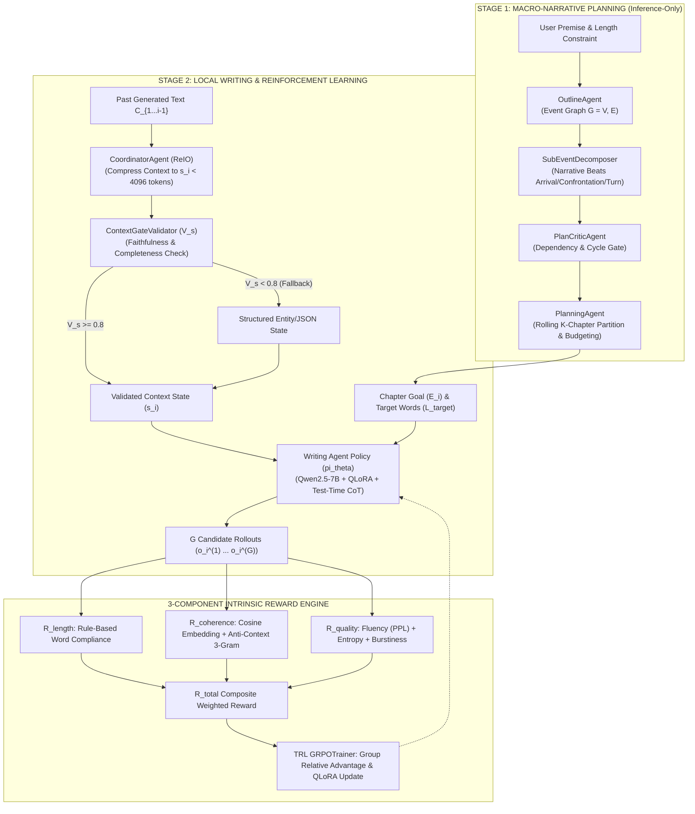
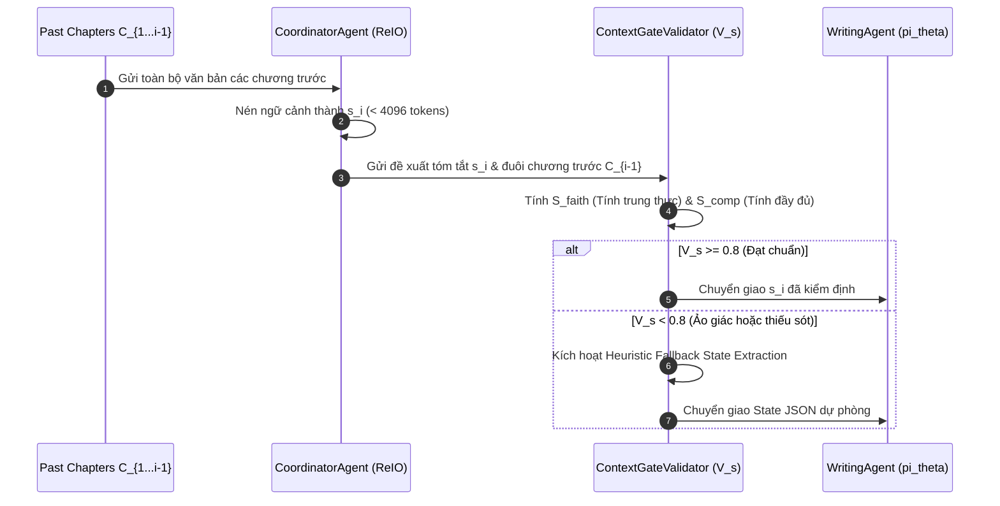
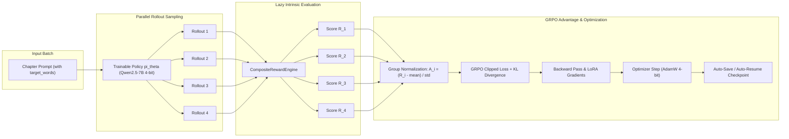

# Kiến Trúc Hệ Thống MA-GRPO (Multi-Agent Group Relative Policy Optimization)

Tài liệu này mô tả chi tiết toàn bộ kiến trúc phần mềm, luồng dữ liệu, các tác nhân (Agents), và động cơ hàm thưởng nội tại (Intrinsic Reward Engine) của thư mục mã nguồn `src/` trong dự án **MA-GRPO**.

---

## 1. Tổng Quan Kiến Trúc (Executive Architecture Overview)

MA-GRPO giải quyết bài toán sinh văn bản tự sự siêu dài (>8.000 đến 15.000 từ) bằng cách **tách rời hoàn toàn khâu quy hoạch vĩ mô (Macro Planning) và khâu viết văn vi mô (Micro-Prose Execution)**:



---

## 2. Chi Tiết Từng Module Trong `src/`

```text
src/
├── __init__.py          # Export các Agent chính và Reward Engine
├── planning/            # Stage 1: Package Lập dàn ý (mỗi Agent một module riêng)
│   ├── story_arc.py     # Story Arc Alignment 5 giai đoạn & Event Graph parser
│   ├── outline_agent.py # OutlineAgent
│   ├── sub_event_agent.py # SubEventAgent & DAG sanitization
│   ├── plan_critic.py   # PlanCriticAgent (5 cổng kiểm duyệt)
│   └── planning_agent.py# PlanningAgent (chia chương & ngân sách từ)
├── coordinator.py       # Stage 2: Tóm tắt ngữ cảnh ReIO, Cổng thẩm định V_s & cơ chế Fallback
├── rewards.py           # Động cơ 3 hàm thưởng nội tại (Length, Coherence, Quality)
├── pipeline.py          # Bộ điều phối End-to-End Orchestrator Pipeline & vLLM/Local Engine
└── dataset_generator.py # Sinh tập dữ liệu Pilot / GRPO Training
```

---

### 2.1. Package `src/planning/` (Macro Planning)

Module chịu trách nhiệm xây dựng cốt truyện toàn cục theo chuẩn lý thuyết kịch bản văn học (Narrative Theory) và phân bổ ngân sách từ vựng.

#### Các lớp chính:
1. **`OutlineAgent`**:
   - **Nhiệm vụ**: Chuyển đổi đề bài (`premise`) thành Đồ thị sự kiện (**Event Graph** $G = (V, E)$).
   - **Cấu trúc sự kiện**: Mỗi sự kiện bao gồm bộ 6 trường ngữ nghĩa: `Setting`, `Character`, `Action`, `Conflict`, `Plot Twist`, `Raw Text`.
   - **Định dạng chuẩn**: Sử dụng regex parser tương thích với chuẩn cấu trúc StoryWriter.
2. **`SubEventDecomposer`**:
   - **Nhiệm vụ**: Phân rã mỗi sự kiện vĩ mô thành các nhịp truyện chi tiết (*Narrative Beats*):
     - `Arrival`: Thiết lập bối cảnh và tình huống ban đầu.
     - `Confrontation`: Xung đột chính giữa các nhân vật.
     - `Turn`: Điểm ngoặt kịch tính phát triển sự kiện.
   - Gán `depends_on` để quản lý đồ thị có hướng không chu trình (DAG).
3. **`PlanCriticAgent`**:
   - Cổng kiểm duyệt đóng băng: Phát hiện sự kiện trùng lặp, sự kiện nhảy cóc chưa thỏa mãn phụ thuộc (`unmet dependencies`), hoặc kế hoạch thiếu ràng buộc số từ.
4. **`PlanningAgent`**:
   - Phân chia $G$ thành $K$ chương độc lập.
   - Tính toán ngân sách từ mục tiêu cho từng chương:
     $$L_{\text{target}} = \frac{L_{\text{total}}}{K}$$
   - Chia tiếp mỗi chương thành 3 cảnh (*Scene Breakdown & Word Budgets*): Cảnh 1 (~25%), Cảnh 2 (~45%), Cảnh 3 (~30%).

---

### 2.2. Module `src/coordinator.py` (Context Coordination & Context Gate)

Module giải quyết bài toán suy giảm ngữ cảnh (*Lost-in-the-Middle*) và ảo giác dây chuyền (*Hallucination Cascades*) khi viết truyện dài qua nhiều chương.



#### Các lớp chính:
1. **`CoordinatorAgent` (Cơ chế ReIO - Rewrite Input and Output)**:
   - Thu gọn toàn bộ lịch sử các chương trước thành trạng thái cô đọng $s_i$ (<4.000 tokens):
     - `plot_summary`: Tiến trình các sự kiện thực tế đã diễn ra.
     - `character_statuses`: Trạng thái tâm lý, thể chất của các nhân vật.
     - `pending_threads`: Các nút thắt chưa giải quyết cần đưa vào chương mới.
     - `recent_tail_excerpt`: Đoạn kết (~150 từ) của chương $C_{i-1}$ để làm móc nối.
2. **`ContextGateValidator` (Cổng kiểm định $V_s$)**:
   - Đo lường chất lượng bản tóm tắt qua công thức:
     $$V_s(s_i) = 0.5 \cdot S_{\text{faith}}(s_i, C_{i-1}) + 0.5 \cdot S_{\text{comp}}(s_i, E_{i-1})$$
   - **Ngưỡng $\tau = 0.8$**: Nếu $V_s < 0.8$, hệ thống từ chối bản tóm tắt tự do và kích hoạt cơ chế `_heuristic_fallback_state` để trích xuất thực thể cứng, bảo đảm không truyền ảo giác vào chương tiếp theo.

---

### 2.3. Module `src/rewards.py` (Unified Intrinsic Reward Engine)

MA-GRPO loại bỏ hoàn toàn LLM Evaluator bên ngoài (như mô hình 72B) để tiết kiệm tài nguyên và độ trễ, thay thế bằng **hệ thống 3 hàm thưởng toán học nội tại (Intrinsic Rewards)**:

$$\mathbf{R_{\text{total}}(o_i^{(k)}) = w_1 \cdot R_{\text{length}} + w_2 \cdot R_{\text{coherence}} + w_3 \cdot R_{\text{quality}}}$$

#### 1. $R_{\text{length}}$ — Kiểm Soát Chiều Dài Từng Chương (Rule-Based O(1))
Loại bỏ hoàn toàn thẻ suy nghĩ `<think>...</think>` trước khi đếm từ thực tế:
$$R_{\text{length}}(o_i^{(k)}) = \max \left( 0, 1 - \frac{|\text{actual\_len}(o_i^{(k)}) - L_{\text{target}}|}{L_{\text{target}}} \right)$$
*Đặc tính*: Bằng cách ép phạt cục bộ ở cấp độ chương, mô hình không thể "ăn gian độ dài" (Reward Hacking) bằng cách lặp từ dông dài.

#### 2. $R_{\text{coherence}}$ — Mạch Chuyển Tiếp & Chống Lặp Ngữ Cảnh (Anti-Context Penalty)
$$R_{\text{coherence}}(o_i^{(k)}) = \text{CosineSim}\left(\text{Embed}(\text{End}(C_{i-1})), \text{Embed}(\text{Start}(o_i^{(k)}))\right) \times \frac{|\text{Uniq3Grams}(o_i^{(k)}) \setminus \text{3Grams}(s_i)|}{|\text{Total3Grams}(o_i^{(k)})|}$$
* **Chuyển tiếp mượt mà**: Sử dụng mô hình `BAAI/bge-small-en-v1.5` đo độ tương đồng giữa đoạn kết chương trước và mở đầu chương hiện tại.
* **Chống lặp ngữ cảnh**: Phạt nặng việc mô hình "chép lại" các cụm 3 từ có sẵn trong bản tóm tắt $s_i$, buộc mô hình dùng văn phong độc lập.

#### 3. $R_{\text{quality}}$ — Đo Lường Chất Lượng Văn Phong Nội Tại
$$\mathbf{R_{\text{quality}} = \alpha \cdot R_{\text{fluency}} + \beta \cdot R_{\text{richness}} + \gamma \cdot R_{\text{burstiness}}}$$
* **$R_{\text{fluency}}$ (Độ trôi chảy qua Perplexity)**: Sử dụng mô hình ngôn ngữ nền siêu nhẹ `Qwen2.5-0.5B`:
  $$R_{\text{fluency}} = \exp \left( - \frac{\text{PPL}(o_i^{(k)})}{\sigma_{\text{ref}}} \right)$$
* **$R_{\text{richness}}$ (Độ giàu từ vựng qua Shannon Entropy)**:
  $$R_{\text{richness}} = \frac{-\sum_{v \in V} P(v) \log_2 P(v)}{H_{\text{max}}}$$
* **$R_{\text{burstiness}}$ (Nhịp điệu câu văn)**: Đo độ biến thiên độ dài các câu thông qua hàm Sigmoid trên độ lệch chuẩn (StdDev).

---

### 2.4. Module `src/pipeline.py` (End-to-End Orchestrator Pipeline)

Kết nối toàn bộ quy trình sinh văn bản và tạo nhóm rollout cho thuật toán GRPO:
1. **`extract_cot_and_prose`**: Phân tách chuỗi suy nghĩ `<think>...</think>` (Test-Time Reasoning) và văn bản tự sự sạch.
2. **`VLLMWritingPolicy`**:
   - Tối ưu hóa cho môi trường GPU thông qua vLLM PagedAttention / Transformers SDPA.
   - Hỗ trợ hàm `generate_rollouts` sinh song song $G$ ứng viên cho mỗi chương phục vụ huấn luyện GRPO.
3. **`construct_prompt`**: Cung cấp cấu trúc chỉ dẫn chuẩn hóa, truyền bối cảnh, mục tiêu số từ và ngân sách từng cảnh vào prompt của Writing Agent.
4. **`EndToEndStoryPipeline`**: Quản lý vòng lặp qua $K$ chương, cập nhật trạng thái Coordinator sau mỗi chương thành công.

---

## 3. Quy Trình Huấn Luyện QLoRA GRPO (`scripts/train.py`)

Module huấn luyện tích hợp trực tiếp với thư viện `trl.GRPOTrainer` và `peft`:



### Điểm kỹ thuật cốt tử:
* **Dynamic Target Extraction**: Trích xuất độ dài mục tiêu trực tiếp từ Prompt nhằm đảm bảo tính chính xác ngay cả khi TRL không truyền metadata qua kwargs.
* **Token Budget (2.200 tokens)**: Đảm bảo độ dài sinh bao gồm cả reasoning `<think>` lẫn văn bản hoàn chỉnh 1.400–1.600 từ mà không bị cắt cụt.
* **Gradient Accumulation**: Căn chỉnh `generation_batch_size` luôn chia hết cho `num_generations` ($G=4$) theo đúng chuẩn của TRL.
* **Auto-Resume**: Quét và tự động nạp checkpoint cao nhất từ Google Drive (`checkpoint-50`, `checkpoint-100`, ...) để tiếp tục huấn luyện liền mạch.

---

## 4. Tóm Tắt Giao Diện Lớp & Dữ Liệu (Class Interface Summary)

| Class | Tệp | Vai trò chính | Trạng thái huấn luyện |
| :--- | :--- | :--- | :--- |
| `OutlineAgent` | `planning.py` | Tạo Event Graph 6 trường ngữ nghĩa | Đông cứng (Inference-Only) |
| `SubEventDecomposer` | `planning.py` | Chia sự kiện thành Arrival / Confrontation / Turn | Đông cứng (Inference-Only) |
| `PlanCriticAgent` | `planning.py` | Kiểm duyệt tính hợp lệ và phụ thuộc của dàn ý | Rule-based |
| `PlanningAgent` | `planning.py` | Chia chương và gán ngân sách từ cho từng cảnh | Rule-based / LLM |
| `CoordinatorAgent` | `coordinator.py` | Nén ngữ cảnh lịch sử ReIO ($s_i < 4096$ tokens) | Đông cứng (Inference-Only) |
| `ContextGateValidator` | `coordinator.py` | Thẩm định tính trung thực & đầy đủ ($V_s \ge 0.8$) | Heuristic / Small NLI |
| `CompositeRewardEngine` | `rewards.py` | Động cơ tổng hợp 3 hàm thưởng nội tại | Không tham số (Frozen Evaluators) |
| `VLLMWritingPolicy` | `pipeline.py` | Điều phối sinh rollout song song | Base Engine |
| `IntrinsicRewardFunctions` | `scripts/train.py` | Cầu nối giữa CompositeRewardEngine và TRL | Adapter Pattern |
| **`WritingAgent (pi_theta)`** | `scripts/train.py` | **Mô hình sinh văn bản chính (Qwen2.5-7B)** | **Huấn luyện duy nhất (QLoRA + GRPO)** |

