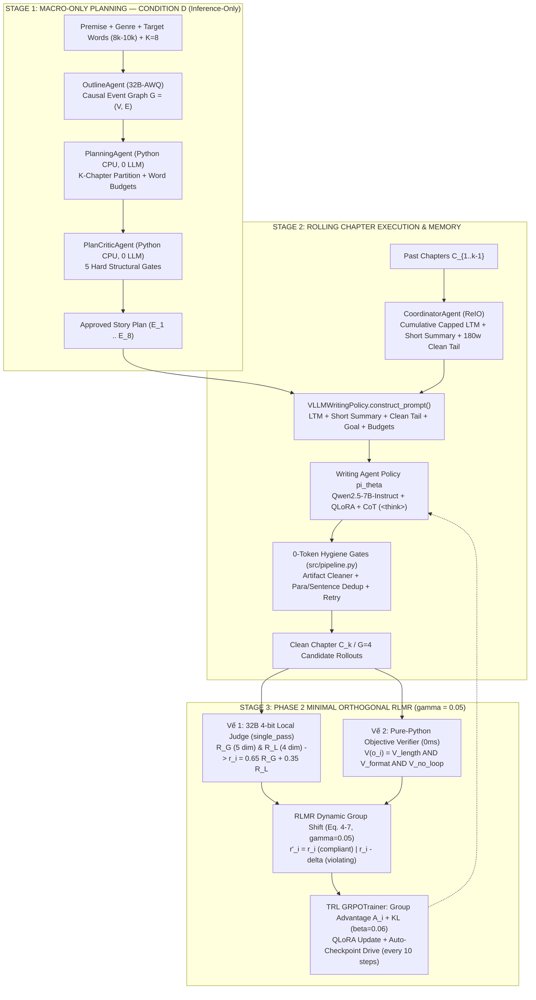
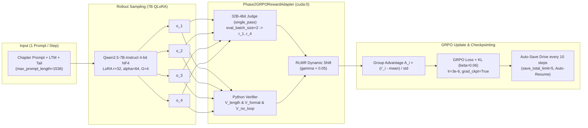

# Kiến Trúc & Pipeline Hệ Thống MA-GRPO (v2 — Condition D + Minimal Orthogonal RLMR)

Tài liệu này đặc tả toàn bộ kiến trúc hệ thống, luồng dữ liệu 3 pha (Data Prep → Offline GRPO Training → Online Inference), cơ chế **Macro-Only Planning (`Condition D`)**, trí nhớ 2 tầng **ReIO + Cumulative LTM**, cổng lọc **0-Token Hygiene Gates**, và động cơ phần thưởng **Phase 2 Minimal Orthogonal RLMR ($\gamma = 0.05$)** của dự án **MA-GRPO**.

---

## 1. Tổng Quan Kiến Trúc & Pipeline Tổng Thể

MA-GRPO giải quyết bài toán sinh truyện dài **8.000 – 12.000+ từ** trên mô hình viết nhỏ (`Qwen2.5-7B-Instruct`) bằng 4 trụ cột đã được kiểm chứng thực nghiệm:

1. **Asymmetric Planner–Writer (`Condition D — Macro-Only`)**: Tách rời hoàn toàn khâu lập dàn ý vĩ mô (dùng `Qwen2.5-32B-Instruct-AWQ` xây Đồ thị Sự kiện Nhân quả thuần $G=(V, E)$, bỏ `SubEventAgent` sau ablation tiết kiệm `63,55%` planning tokens và bỏ ép cứng Freytag 5 pha) khỏi khâu viết văn xuôi vi mô (`Qwen2.5-7B-Instruct` QLoRA).
2. **Two-Tier Cumulative Memory (`CoordinatorAgent` ReIO) + 0-Token Hygiene Gates**: Nén lịch sử các chương đã viết thành Bộ nhớ Dài hạn tích lũy có trần (`[LONG-TERM STORY MEMORY]`) + Bộ nhớ Ngắn hạn (`[CONTEXT SUMMARY]` + 180 từ cuối cắt đúng ranh giới câu `extract_clean_tail`). Loại bỏ hoàn toàn `ContextGateValidator` (đã chứng minh dư thừa/phản tác dụng qua ablation) và thay bằng 2 cổng Python/Regex `0` token (`clean_generation_artifacts` + `deduplicate_repeated_paragraphs`).
3. **Phase 2 Minimal Orthogonal RLMR ($\gamma = 0.05$)**: Giải quyết triệt để **Expansion Reward Hacking** & **Fixed Penalty Failure** (theo RLMR, AAAI 2026) bằng kiến trúc 2 vế trực giao không đếm trùng:
   - **Vế 1 (Semantic Quality — 32B 4-bit Local Judge):** $r_i = 0.65 R_G + 0.35 R_L \in [0, 1]$ (`unsloth/Qwen2.5-32B-Instruct-bnb-4bit`, `single_pass=True`).
   - **Vế 2 (Hard Objective Verifier — Pure Python 0ms):** $V(o_i) = V_{\text{length}} \wedge V_{\text{format}} \wedge V_{\text{no\_loop}}$ kèm dịch chuyển nhóm động $\delta$ đảm bảo mọi rollout vi phạm đều nhận GRPO Advantage âm ($\hat{A}_j < 0$).
4. **Hệ Thống Benchmark 3 Bộ Độc Lập**: `MacroPlan-Bench` (chất lượng dàn ý), `FullStory-Bench` (chất lượng truyện dài 8–10 chương), và `ClassicNLG-Bench` (chỉ số NLG cổ điển & tương quan Spearman).



---

## 2. Phân Công Mô Hình & Vận Hành Theo 3 Pha

| Thành phần / Module | Pha 0: Tạo Tập Train *(Chạy 1 lần)* | Pha 1: Offline GRPO Train *(1× A100 80GB)* | Pha 2: Online Inference *(A100 40GB / 80GB)* |
| :--- | :--- | :--- | :--- |
| **`OutlineAgent`** | `Qwen/Qwen2.5-32B-Instruct-AWQ` *(vLLM batch)* | **TẮT** *(đọc tĩnh từ JSONL)* | `Qwen/Qwen2.5-32B-Instruct-AWQ` *(xong Stage 1 thì xả VRAM)* |
| **`PlanningAgent` (`Cond D`)** | Python CPU *(0 LLM calls)* | **TẮT** | Python CPU *(0 LLM calls)* |
| **`PlanCriticAgent`** | Python CPU *(0 LLM calls)* | **TẮT** | Python CPU *(0 LLM calls)* |
| **`CoordinatorAgent` (ReIO)** | `Qwen/Qwen2.5-32B-Instruct-AWQ` *(đóng hộp LTM + Short Summary + 180w Clean Tail)* | **TẮT** *(đọc tĩnh từ JSONL)* | `Qwen/Qwen2.5-7B-Instruct` base *(tắt LoRA trên cùng engine)* hoặc `32B-AWQ` |
| **`Writing Agent` ($\pi_\theta$)** | `32B-AWQ` sinh nháp nối ngắn `900` tok *(chỉ Ch 1–7 để nối mạch, không dùng làm SFT label)* | **`Qwen/Qwen2.5-7B-Instruct` 4-bit QLoRA** *(cập nhật duy nhất, $G=4$, `max_tokens=2200`)* | **`Qwen/Qwen2.5-7B-Instruct` + GRPO LoRA** *(viết đủ 8 chương, $G=1$)* |
| **`0-Token Hygiene Gates`** | Bật trên nháp nối Ch 1–7 | Không cắt rollout lúc train *(để Verifier phạt thật)* | **Bật bắt buộc** trước khi lưu chương & đưa vào Coordinator |
| **`Phase 2 Reward Engine`** | Không chạy | **`unsloth/Qwen2.5-32B-Instruct-bnb-4bit`** *(~20–22 GB VRAM)* + **Python RLMR Verifier** *(0 GB)* | Dùng offline trong `audit_phase2_rewards.ipynb` & Benchmark |

### Kết quả thực tế của Tập Huấn Luyện Pha 0 (`data/grpo_train_condition_d.jsonl`)
- **Quy mô:** `80` premises MoPS (`14` thể loại, `0%` trùng lặp với tập test) × `8` chương = **`640` chapter prompts** (`9.23 MB`), kèm `80` macro plans lưu tại `data/grpo_train_condition_d_macro_plans.json` (`6.21 MB`).
- **Chất lượng kiểm toán (`dataset_quality_report.json`):** `640/640` parser OK, `560/560` Ch2+ mang đầy đủ `[LONG-TERM STORY MEMORY]` + `extract_clean_tail` nguyên câu, `0` fallbacks, `0` artifact leaks, `max_prompt_words = 829` (khớp gọn trong `max_prompt_length = 1536`).
- **Điểm Macro Plan trung bình:** $S_{\text{cov}} = 0.9689$, $S_{\text{causal}} = 1.0$, $S_{\text{comp}} = 1.0$, $\text{Concreteness} = 0.9587$, $\text{PacingBalance} = 0.9653$, $\text{CriticPass} = 1.0$.

---

## 3. Cấu Trúc Mã Nguồn Repository (`MA-GRPO/`)

```text
MA-GRPO/
├── src/                                    # CORE PAPER CODE (Frozen public surface)
│   ├── __init__.py                         # Export các Agent cốt lõi & Pipeline
│   ├── planning/                           # Stage 1: Macro-Only Planning Package
│   │   ├── story_arc.py                    # Causal Event Graph parser (không ép Freytag 5 pha)
│   │   ├── outline_agent.py                # OutlineAgent (Event Graph G=(V, E))
│   │   ├── sub_event_agent.py              # SubEventAgent (chỉ dùng cho nhánh đối chứng Condition E)
│   │   ├── plan_critic.py                  # PlanCriticAgent (5 cổng kiểm duyệt cấu trúc cứng)
│   │   └── planning_agent.py               # PlanningAgent (Condition D: chia K chương & ngân sách từ)
│   ├── coordinator.py                      # ReIO Two-Tier Memory + compact_long_term_memory + extract_clean_tail
│   ├── pipeline.py                         # VLLMWritingPolicy, Hygiene Gates (Cleaner + Dedup), MAGRPOPipeline
│   ├── dataset_generator.py                # ConditionDGRPODatasetGenerator (batch vLLM + resume + macro_plans.json)
│   └── rewards.py                          # Phase 1 Baseline Intrinsic Reward (giữ cho EXP-00 đối chứng)
│
├── rewards/                                # PHASE 2 EXPANSION REWARD & MINIMAL ORTHOGONAL RLMR
│   ├── base.py                             # EvaluationInput, LocalScores, GlobalScores, RewardBreakdown
│   ├── evaluators/
│   │   ├── local_llm_backend.py            # LocalHF4BitJudgeBackend (32B-4bit HF) & MockDeterministicJudgeBackend
│   │   ├── evaluator_schema.py             # Rubric JSON schemas (Local 4-dim, Global 5-dim, Unified single-pass)
│   │   ├── unified_evaluator.py            # Single-pass Local + Global evaluator (mặc định tối ưu tốc độ)
│   │   ├── local_evaluator.py              # LocalExpansionEvaluator (EXP-03 / 2-pass)
│   │   ├── global_evaluator.py             # GlobalChapterEvaluator (EXP-04 / 2-pass)
│   │   ├── holistic_evaluator.py           # HolisticChapterEvaluator (EXP-01 baseline)
│   │   └── constraint_evaluator.py         # verify_objective_constraints (Pure Python RLMR) + legacy penalties
│   ├── aggregation/
│   │   ├── hierarchical.py                 # Phase2RewardEngine + apply_rlmr_dynamic_shift (Eq. 4-7, gamma=0.05)
│   │   ├── arithmetic.py                   # Weighted arithmetic pooling
│   │   └── geometric.py                    # Weighted geometric pooling (EXP-05)
│   ├── validation/                         # reward_correlation.py, reward_hacking.py, human_alignment.py
│   └── configs/                            # exp00_baseline .. exp05_hierarchical_geo + exp02_rlmr_orthogonal.yaml
│
├── experiments/
│   ├── conditions/condition_a..e/          # 5 điều kiện Ablation (A: Zero-Plan .. E: Full Hierarchy)
│   ├── perturbation/                       # 5 phép nhiễu cấu trúc kiểm chứng nhạy cảm dàn ý
│   ├── benchmark/                          # Two-Track Macro-Planning Benchmark (Track 1 VR-CLI & Track 2)
│   └── benchmarks/                         # 3 Standalone Benchmark Suites:
│       ├── outline_bench/                  # Suite 1: MacroPlan-Bench
│       ├── fullstory_bench/                # Suite 2: FullStory-Bench (ConStory-Checker + EQ-Bench + DOC-NLI)
│       └── classic_nlg_bench/              # Suite 2A: ClassicNLG-Bench (BLEU, ROUGE-L, Distinct, Entropy, PPL)
│
├── scripts/                                # Entrypoints CLI
│   ├── generate_grpo_dataset.py            # Sinh tập train Condition D bằng vLLM 32B-AWQ
│   ├── train.py                            # QLoRA GRPOTrainer (hỗ trợ --reward-config Phase 2 & auto-resume)
│   ├── audit_rewards_offline.py            # Kiểm toán phân phối reward & RLMR shift trước khi train
│   └── benchmark_{outline,fullstory,classic_nlg}.py
├── notebooks/                              # Colab A100 Notebooks (train_grpo_phase2_a100.ipynb, ...)
├── configs/                                # colab_a100.yaml, server_40gb.yaml
├── data/                                   # grpo_train_condition_d.jsonl (640 prompts), test sets
└── tests/                                  # 66 unit & boundary tests (100% pass trên CPU)
```

---

## 4. Chi Tiết Động Cơ Phần Thưởng Phase 2 (`Minimal Orthogonal RLMR`)

### 4.1. Tại sao nâng cấp từ Phase 1 Intrinsic (`src/rewards.py`) lên Phase 2 RLMR (`rewards/`)?
- **Hạn chế của Phase 1:** Các hàm toán học thuần ($R_{\text{length}}$, Cosine MiniLM, PPL `0.5B`) dễ bị *Expansion Reward Hacking* — mô hình viết dài đủ chữ bằng các đoạn mô tả sáo rỗng, lặp ý diễn đạt lại (*filler*) hoặc làm sai mạch cốt truyện/mâu thuẫn LTM mà điểm PPL & độ dài vẫn rất cao.
- **Hạn chế của Fixed Penalty ($R_q - \sum \lambda_m P_m$):** Khi chọn $\lambda$ cố định quá nhỏ, một rollout vi phạm độ dài/format nhưng viết văn hay vẫn có $r_{\text{vio}} > \bar{r}_{\text{group}}$ → nhận **Advantage dương**, bị GRPO khuếch đại lỗi! Ngược lại nếu cộng nhiều $\lambda$ trùng lặp ngữ nghĩa với Judge (như phạt lặp + phạt mâu thuẫn bằng cả LLM lẫn Python), reward bị *double-counting* và méo gradient.

### 4.2. Công Thức Tối Giản Trực Giao (`exp02_rlmr_orthogonal.yaml`, $\gamma = 0.05$)

Mỗi nhóm $G = 4$ rollout $\{o_1, o_2, o_3, o_4\}$ sinh ra từ cùng 1 chapter prompt được chấm qua 2 vế hoàn toàn trực giao:

1. **Vế 1 — Chất Lượng Ngữ Nghĩa (`unsloth/Qwen2.5-32B-Instruct-bnb-4bit`, `single_pass=True`):**
   - **Global Score $R_G$ (5 tiêu chí):** `narrative_coherence` (0.25), `character_consistency` (0.20), `pacing_structure` (0.20), `ending_transition` (0.15), `long_term_consistency` (0.20).
   - **Local Score $R_L$ (4 tiêu chí):** `meaningful_elaboration` (0.30), `scene_vividness` (0.25), `dialogue_interaction` (0.20), `natural_expansion` (0.25).
   - **Raw Quality Score:**
     $$r_i = 0.65 \cdot R_G(o_i) + 0.35 \cdot R_L(o_i) \in [0, 1]$$
   *(Judge 32B đã chịu trách nhiệm toàn bộ về mâu thuẫn cốt truyện, độ sáo rỗng, và mở rộng vô nghĩa — tuyệt đối không lặp lại bằng Python.)*

2. **Vế 2 — Xác Thực Cứng Khách Quan (`verify_objective_constraints`, Pure Python `< 1ms`):**
   $$V(o_i) = V_{\text{length}}(o_i) \;\wedge\; V_{\text{format}}(o_i) \;\wedge\; V_{\text{no\_loop}}(o_i)$$
   - $V_{\text{length}}$: Số từ văn xuôi (đã bỏ `<think>`) nằm trong $[0.85 \cdot L_{\text{target}},\; 1.15 \cdot L_{\text{target}}]$.
   - $V_{\text{format}}$: Có đóng thẻ `</think>` đúng chuẩn, độ dài `<think>` $\le 400$ từ, không rò rỉ token đặc biệt (`</assistant>`, `<|im_end|>`, `[INST]`, ...).
   - $V_{\text{no\_loop}}$: Không lặp nguyên đoạn văn dài (`> 30` từ, Jaccard $\ge 0.88$) hoặc lặp câu (`> 12` từ).

3. **RLMR Dynamic Group Shift ($\gamma = 0.05$, theo AAAI 2026 Eq. 4–7):**
   Gọi $k$ là số rollout vi phạm ($V(o_j) = 0$) trong nhóm $n = 4$:
   - **Trường hợp $0 < k < n$:**
     $$\delta = \max\left(0,\; \frac{n \cdot r_{\max}^{\text{vio}} + n \cdot \gamma - \sum_{i=1}^{n} r_i}{n - k}\right), \qquad r'_i = \begin{cases} r_i & \text{nếu } V(o_i) = 1 \\ r_i - \delta & \text{nếu } V(o_i) = 0 \end{cases}$$
     *Chứng minh toán học:* Mọi rollout vi phạm chắc chắn thỏa $r'_j \le \bar{r}' - \gamma \implies \hat{A}_j < 0$, trong khi thứ tự tương đối giữa các rollout đạt chuẩn được giữ nguyên 100%.
   - **Trường hợp $k = 0$ (cả 4 đều đạt chuẩn):** $r'_i = r_i$ (tối ưu thuần chất lượng văn chương).
   - **Trường hợp $k = n$ (cả 4 đều vi phạm — Safe Fallback):** $r'_i = r_i \cdot \text{length\_compliance} \cdot f_{\text{format}} \cdot f_{\text{loop}}$ (tránh chia 0 và giữ tín hiệu gradient học dần về vùng hợp lệ thay vì vứt bỏ nhóm rollout đắt đỏ).

---

## 5. Quy Trình Huấn Luyện QLoRA GRPO Co-Residency (`scripts/train.py`)



### Ngân sách VRAM & Thông số vận hành thực tế trên 1× A100 80GB
- **Policy `Qwen2.5-7B-Instruct` 4-bit QLoRA** (`grad_ckpt=True`, `G=4`, `max_completion=2200`): `~28 – 34 GB`.
- **Judge `unsloth/Qwen2.5-32B-Instruct-bnb-4bit`** (HF `transformers` + `bitsandbytes`, `torch.inference_mode()` — **không** dùng vLLM chung process với TRL để tránh xung đột KV-cache allocator): `~20 – 22 GB`.
- **Python RLMR Verifier**: `0 GB` VRAM, `< 1 ms`.
- **Tổng VRAM:** **`~50 – 56 GB / 80 GB`** (dư >24 GB an toàn).
- **Nhịp độ train:** `~55 – 80 giây / step` (`1` prompt × `4` rollouts/step), lưu checkpoint lên Google Drive mỗi `10` steps (`~10 – 13 phút / checkpoint`), hỗ trợ ngắt/nối phiên Colab không mất bước.

---

## 6. Bảng Tóm Tắt Giao Diện Lớp & Module

| Thành phần | Tệp | Vai trò chính | Trạng thái trong GRPO |
| :--- | :--- | :--- | :--- |
| `OutlineAgent` | `src/planning/outline_agent.py` | Tạo Causal Event Graph $G=(V,E)$ (6 trường + `Depends On`) | Frozen (`32B-AWQ`) |
| `PlanningAgent` | `src/planning/planning_agent.py` | Chia $K$ chương & ngân sách từ (`Condition D` Macro-Only) | Python CPU (`0` LLM) |
| `PlanCriticAgent` | `src/planning/plan_critic.py` | 5 cổng kiểm duyệt cứng (Coverage, DAG, Character, Budget, Ordering) | Python CPU (`0` LLM) |
| `CoordinatorAgent` | `src/coordinator.py` | ReIO Two-Tier Memory + `compact_long_term_memory` + `extract_clean_tail` | Frozen (`32B` Pha 0 / `7B` Online) |
| `Hygiene Gates` | `src/pipeline.py` | `clean_generation_artifacts` + `deduplicate_repeated_paragraphs` (+ retry) | Python/Regex (`0` token) |
| `VLLMWritingPolicy` | `src/pipeline.py` | Dựng prompt chuẩn (`construct_prompt`) đồng nhất Train/Test & sinh truyện | Inference Wrapper |
| `LocalHF4BitJudgeBackend` | `rewards/evaluators/local_llm_backend.py` | Nạp `Qwen2.5-32B-Instruct-bnb-4bit` chấm JSON Local + Global (`single_pass`) | Frozen Judge (4-bit) |
| `verify_objective_constraints` | `rewards/evaluators/constraint_evaluator.py` | Kiểm tra nhị phân $V_{\text{length}} \wedge V_{\text{format}} \wedge V_{\text{no\_loop}}$ | Pure Python (`0` VRAM) |
| `Phase2RewardEngine` + `apply_rlmr_dynamic_shift` | `rewards/aggregation/hierarchical.py` | Tổng hợp $r_i = 0.65 R_G + 0.35 R_L$ & áp dịch chuyển nhóm động $\delta$ ($\gamma=0.05$) | Reward Engine |
| `Phase2GRPORewardAdapter` | `scripts/train.py` | Cầu nối chuẩn `TRL GRPOTrainer` + log `phase2_reward_logs.jsonl` | Adapter Pattern |
| **`WritingAgent` ($\pi_\theta$)** | `scripts/train.py` | **`Qwen2.5-7B-Instruct` + QLoRA (`r=32, alpha=64`)** | **Thành phần duy nhất được train** |
